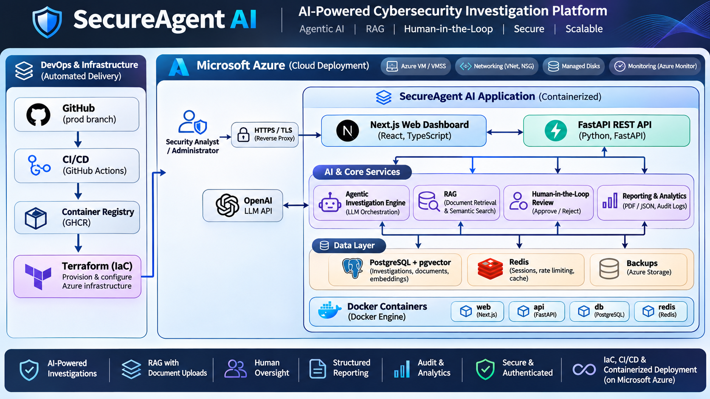
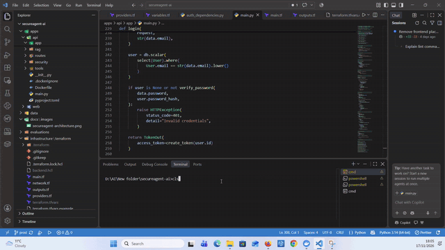

# SecureAgent AI

**A security-focused, agentic AI platform for cybersecurity investigations, retrieval-augmented analysis, human-in-the-loop review, and auditable reporting.**

SecureAgent AI combines large language models, retrieval-augmented generation (RAG), structured cybersecurity investigation workflows, and secure backend services to support the analysis of security events and documents.

The platform is designed around a principle of **human oversight of AI-generated security findings**, with authenticated access, structured investigation reports, analyst review workflows, and audit records.

</div>




## 🎬 SecureAgent AI — Application Demo

Watch SecureAgent AI in action, demonstrating its
cybersecurity investigation and AI-powered workflows.



**Demo duration:** 50 seconds (fast-forwarded)


## Key Features

### AI-Powered Cybersecurity Investigations

- Analyze structured cybersecurity events using LLM-assisted investigation workflows.
- Generate structured reports containing risk assessments and security findings.
- Categorize investigation severity as low, medium, high, or critical.
- Store and retrieve investigation results for authenticated users.

### Retrieval-Augmented Generation (RAG)

- Upload and work with supported documents, including PDF and TXT files.
- Retrieve relevant document context to support AI-generated answers.
- Integrate document retrieval into AI-assisted analysis workflows.

### Human-in-the-Loop Review

- Track investigations requiring analyst review.
- Support approval and rejection decisions.
- Distinguish pending, reviewed, and review-not-required investigations.
- Incorporate review status into reports and analytics.

### Reporting and Analytics

- Generate structured investigation reports.
- Export supported reports in PDF and JSON formats.
- View security analytics and investigation summaries.
- Maintain audit records for supported investigation and reporting actions.

### Authentication and Security

- JWT-based authentication.
- Password hashing.
- User-specific access to saved investigation reports.
- Redis-backed authentication rate limiting.
- Environment-based production configuration validation.
- Configurable CORS and container network settings.

## Technology Stack

| Layer | Technologies |
|---|---|
| Frontend | Next.js, React, TypeScript |
| Backend | Python, FastAPI, Pydantic |
| AI | OpenAI API, LLM-assisted workflows |
| Retrieval | RAG, PostgreSQL, pgvector |
| Database | PostgreSQL |
| Cache and security | Redis |
| Authentication | JWT, password hashing |
| Infrastructure | Docker, Docker Compose |
| CI/CD | GitHub Actions, GitHub Container Registry |
| Deployment | Production hosting configuration in progress |

## Architecture

```text
                    SecureAgent AI
                          |
                    Next.js Frontend
                          |
                     FastAPI API
                          |
          +---------------+---------------+
          |               |               |
    Authentication   AI Investigation   RAG Services
          |               |               |
          +---------------+---------------+
                          |
                  PostgreSQL + pgvector
                          |
                         Redis

Supporting workflows:
- Human analyst review
- Structured report generation
- PDF and JSON exports
- Audit history
- Security analytics
```

The frontend communicates with the FastAPI backend, which coordinates authentication, AI-assisted investigations, document retrieval, report persistence, and supporting services.

## Project Structure

```text
secureagent-ai/
├── apps/
│   ├── api/
│   │   ├── main.py
│   │   ├── app/
│   │   ├── agents/
│   │   ├── rag/
│   │   ├── security/
│   │   ├── tools/
│   │   └── routes/
│   └── web/
│       ├── app/
│       ├── components/
│       └── Dockerfile
├── data/
│   ├── sample_documents/
│   └── synthetic_logs/
├── evaluations/
│   ├── rag/
│   ├── agent_tasks/
│   └── security_tests/
├── tests/
│   ├── unit/
│   ├── integration/
│   └── e2e/
├── infrastructure/
│   └── terraform/
├── .github/
│   └── workflows/
│       ├── ci.yml
│       └── deploy.yml
├── docker-compose.yml
├── Dockerfile
├── .env.example
├── README.md
├── SECURITY.md
└── LICENSE
```

Some directories are reserved for future development and deployment work.

## Getting Started

### Prerequisites

- Docker Desktop or Docker Engine with Docker Compose
- Git
- An OpenAI API key
- Python 3.12 and Node.js 22 for development outside Docker

### 1. Clone the repository

```bash
git clone https://github.com/tharinduyasarathna/SecureAgent-AI.git
cd SecureAgent-AI
```

### 2. Configure environment variables

Copy the example environment file:

```bash
cp .env.example .env
```

On Windows PowerShell:

```powershell
Copy-Item .env.example .env
```

Configure the required values in `.env`, including:

```dotenv
APP_ENV=production
POSTGRES_PASSWORD=replace-with-strong-database-password
JWT_SECRET=replace-with-a-long-cryptographically-random-secret
OPENAI_API_KEY=your-openai-api-key
OPENAI_MODEL=your-supported-model-name
```

Use real, securely generated credentials. Never commit `.env` or API keys to Git.

### 3. Start the application

```bash
docker compose up -d --build
```

### 4. Access the local services

| Service | URL |
|---|---|
| Web application | http://localhost:3000 |
| FastAPI health endpoint | http://127.0.0.1:8766/health |
| Dependency readiness | http://127.0.0.1:8766/ready |
| API documentation | http://127.0.0.1:8766/docs |

These addresses apply to the current local Docker Compose configuration.

### 5. Stop the application

```bash
docker compose down
```

Do not use `docker compose down -v` unless you intentionally want to remove the associated Docker volumes, including PostgreSQL data.

## Application Workflow

1. **Authenticate:** Register or log in to the application.
2. **Provide evidence:** Upload supported documents or submit structured security events.
3. **Investigate:** Run AI-assisted cybersecurity analysis.
4. **Review findings:** Examine the generated risk assessment and structured report.
5. **Human review:** Approve or reject investigations that require analyst review.
6. **Report:** View saved reports and export supported formats.
7. **Analyze:** Explore investigation statistics and audit history.

AI-generated conclusions should be reviewed by a qualified analyst before being used for consequential security decisions.

## CI/CD

The project uses GitHub Actions for automated build validation and production image publishing.

### Continuous Integration

The CI workflow validates backend Python syntax, builds the Next.js application, and builds the FastAPI and Next.js Docker images.

### Continuous Deployment

The CD workflow is being configured to publish production Docker images to GitHub Container Registry from the `prod` branch.

Production server provisioning, HTTPS configuration, persistent storage backups, and automated server rollout are separate deployment milestones.

## Security Considerations

SecureAgent AI incorporates application-level security controls, including JWT authentication, password hashing, rate limiting, and user-scoped report access.

These controls do not constitute a completed independent security audit. Additional deployment hardening, authorization verification, monitoring, and operational controls are required before handling sensitive production data.

Do not upload real credentials, secrets, or confidential security evidence to an unapproved environment.

## Infrastructure as Code (Terraform)

SecureAgent AI includes Terraform-based Infrastructure as Code (IaC) configurations for defining and managing Microsoft Azure infrastructure.

The Terraform configuration provides a reusable foundation for deploying containerized applications and managing supporting cloud resources.

### Azure Infrastructure Components

- **Azure Resource Group:** Organizes project-specific cloud resources.
- **Azure Container Registry (ACR):** Provides private container image storage.
- **Azure Container Apps Environment:** Defines the managed environment for containerized application workloads.
- **Azure Log Analytics:** Provides centralized logging infrastructure.
- **Optional FastAPI Container App:** Defines a configurable backend hosting resource.
- **Environment Configuration:** Supports parameterized deployment environments, resource tagging, and configurable resource allocations.

### Terraform Project Structure

```text
infrastructure/
└── terraform/
    ├── versions.tf
    ├── providers.tf
    ├── variables.tf
    ├── main.tf
    ├── outputs.tf
    ├── terraform.tfvars.example
    ├── .gitignore
    └── README.md
```

### Terraform Validation

Initialize and validate the configuration:

```bash
cd infrastructure/terraform
terraform init
terraform fmt -recursive
terraform validate
```

Review the proposed infrastructure before deployment:

```bash
terraform plan
```

Terraform configuration is maintained as part of the repository to support reproducible infrastructure provisioning and future deployment automation.

**Deployment status:** Terraform infrastructure definitions are available, but a complete production deployment of SecureAgent AI has not yet been established.


## Development Status

**Active development — cloud infrastructure and production deployment preparation**

SecureAgent AI has been developed and run locally using Docker Compose. Backend and frontend Docker images have been built successfully through GitHub Actions.

The repository also includes Terraform infrastructure definitions for Azure resource provisioning, container hosting infrastructure, registry management, and centralized logging.

Current development priorities include:

- Completing cloud deployment and HTTPS configuration.
- Integrating application secrets and persistent data services.
- Automating infrastructure provisioning and application rollout.
- Expanding security testing and operational monitoring.
- Validating production readiness.

The application is not currently represented as a production-hosted or independently security-audited service.

## Author

**Tharindu Lakshan Yasarathna**

PhD Researcher in Computer Science — University College Dublin

Research interests include adversarial machine learning, cybersecurity, anomaly detection, AI robustness, and trustworthy AI systems.

GitHub: https://github.com/tharinduyasarathna

## License

Refer to the repository's `LICENSE` file for the applicable license terms.

---

**SecureAgent AI — Building more secure, transparent, and accountable AI-assisted cybersecurity workflows.**